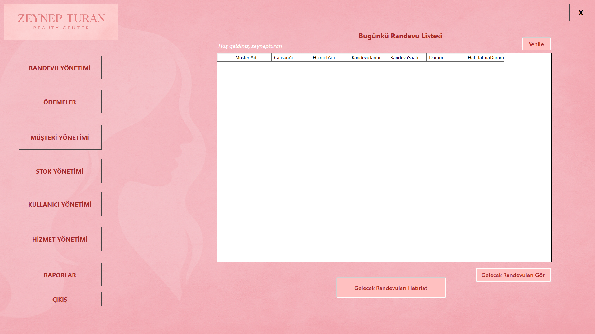
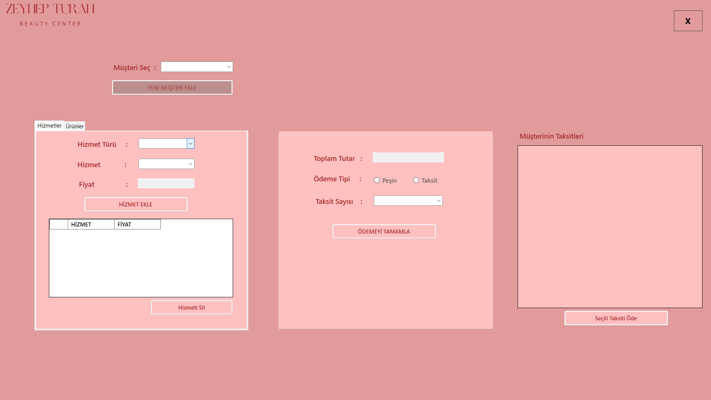
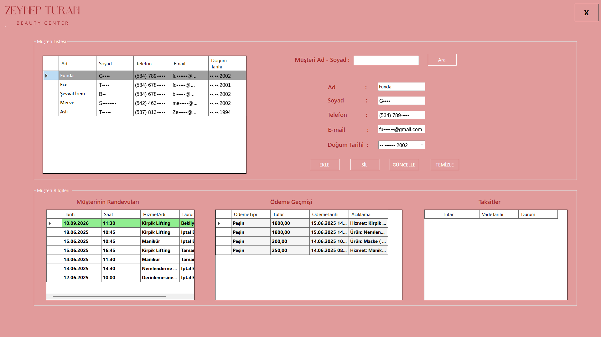
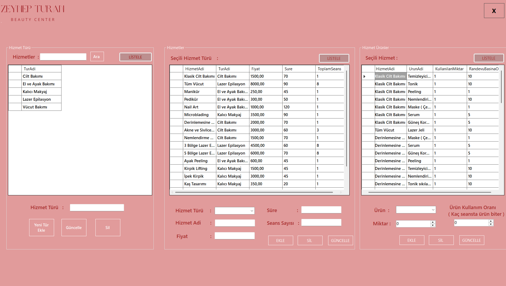

# Beauty Center Automation 💆‍♀️

A desktop application for managing a beauty center: appointments, customers, services, payments, staff and stock. Built with **C# Windows Forms** and **Microsoft SQL Server**. Only the owner and employees use it; customers have no access.

> The application interface is in Turkish.

<p align="center">
  
</p>

## Features

- **Role-based login:** manager and staff accounts with different permissions
- **Appointments:** create, edit and cancel appointments, view today's list and send reminders for upcoming ones
- **Customers:** customer records with appointment history, payment history and installments
- **Services:** service categories, prices, durations, session counts and the products each service uses
- **Payments:** cash or installment payments for services and product sales, with installment tracking
- **Stock:** product stock with movement history; stock is deducted automatically when a service is completed or a product is sold
- **Reports and user management**

## Screenshots

| Login | Payments |
|---|---|
|  |  |

| Customers | Services |
|---|---|
|  |  |

*Customer details in the screenshot are partially masked.*

## Database

14 tables covering employees, customers, services, appointments, products, stock movements, payments, installments and sales. The full schema is in [`database-schema.sql`](database-schema.sql).

## Tech Stack

C# · Windows Forms (.NET) · Microsoft SQL Server · Visual Studio

## Getting Started

1. Clone the repository:
   ```bash
   git clone https://github.com/YOUR_USERNAME/BeautyCenterAutomation.git
   ```
2. In SQL Server Management Studio, create an empty database and run [`database-schema.sql`](database-schema.sql) on it.
3. Search the project for `Data Source` and set the connection string to your own server and database:
   ```
   Data Source=YOUR_SERVER_NAME\SQLEXPRESS;Initial Catalog=YOUR_DATABASE_NAME;Integrated Security=True;TrustServerCertificate=True
   ```
4. Open the `.sln` file in Visual Studio and press **F5**.
5. On the login screen, use **Kayıt Ol** (Register) to create the first user.

## About

Developed by **Zeynep Turan**, Computer Programming program, Bursa Uludağ University.

## License

[MIT](LICENSE)
